# Apache CouchDB 3.5.3 (Erlang) vs CouchRS, on AWS

Apache CouchDB 3.5.3 and CouchRS with its hybrid engine (RocksDB for documents, B-tree index files for views) ran at the same time on AWS (us-east-1a, one cluster placement group), each on its own i4i.4xlarge server with its own c7i.4xlarge load generator, against byte-identical data: 100 GB in 3.9M documents sized from 100 bytes to 1 GB, filled with generated English-like text. Each was loaded, then measured for writes, reads, deletes, view indexing and queries, connection scaling, view compaction, replication and compaction.

- **Dataset:** 100 GB, 3.9M documents
- **Servers:** i4i.4xlarge (16 vCPU, 128 GB RAM, local NVMe), one per server
- **Load generators:** c7i.4xlarge, one per server
- **Run:** 2026-10-22

Generated by `bench/report_md.py` from `bench/results-aws.json`. The interactive version, `bench/report-aws.html`, opens in a browser (GitHub shows it only as source) and also covers the two other CouchRS builds that ran alongside.

## Summary

How many times faster CouchRS is than CouchDB on each headline measure. Right of 1× means CouchRS is faster; left means CouchDB is faster.

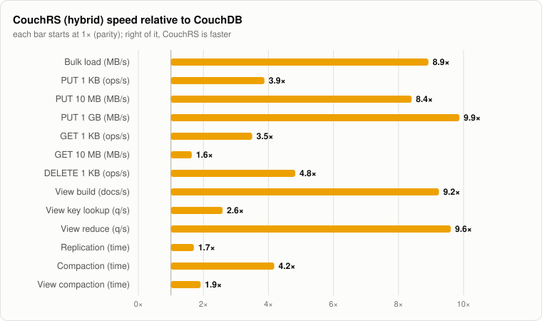

| Benchmark | CouchDB (Erlang) | CouchRS (hybrid) | CouchRS speed |
|:--|--:|--:|--:|
| Bulk load (MB/s) | 40.8 MB/s | 364 MB/s | 8.92× |
| PUT 1 KB (ops/s) | 3.8K/s | 15K/s | 3.88× |
| PUT 10 MB (MB/s) | 68.4 MB/s | 574 MB/s | 8.40× |
| PUT 1 GB (MB/s) | 20.2 MB/s | 199 MB/s | 9.87× |
| GET 1 KB (ops/s) | 8.7K/s | 30K/s | 3.50× |
| GET 10 MB (MB/s) | 943 MB/s | 1.5K MB/s | 1.64× |
| DELETE 1 KB (ops/s) | 2.9K/s | 14K/s | 4.83× |
| View build (docs/s) | 11K/s | 100K/s | 9.24× |
| View key lookup (q/s) | 8.7K/s | 22K/s | 2.59× |
| View reduce (q/s) | 1.1K/s | 11K/s | 9.61× |
| Replication (time) | 27.9 min | 16.4 min | 1.71× |
| Compaction (time) | 11.6 min | 2.8 min | 4.18× |
| View compaction (time) | 29.5 s | 15.4 s | 1.91× |

## Bulk load

The whole dataset, loaded with 16 concurrent connections: small docs through `_bulk_docs` (1,000 per batch), large ones as streamed single-document uploads. CouchDB: 100 GB in 41.0 min. CouchRS: 100 GB in 4.6 min.

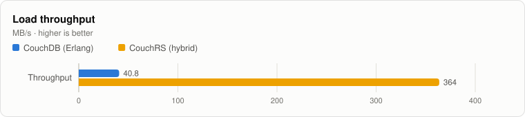

|  | CouchDB (Erlang), MB/s | CouchRS (hybrid), MB/s | CouchRS vs CouchDB |
|:--|--:|--:|--:|
| Throughput | 40.8 | 364 | 8.92× faster |

|  | CouchDB (Erlang), docs/s | CouchRS (hybrid), docs/s | CouchRS vs CouchDB |
|:--|--:|--:|--:|
| Documents | 1.6K | 14K | 8.92× faster |

## Writes

Single-document PUTs of exact sizes, written into the loaded database. Docs up to 64 KB are JSON; larger ones carry the bytes as one attachment, uploaded as `multipart/related`.

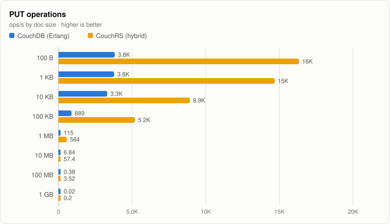

|  | CouchDB (Erlang), ops/s | CouchRS (hybrid), ops/s | CouchRS vs CouchDB |
|:--|--:|--:|--:|
| 100 B | 3.8K | 16K | 4.27× faster |
| 1 KB | 3.8K | 15K | 3.88× faster |
| 10 KB | 3.3K | 8.9K | 2.69× faster |
| 100 KB | 889 | 5.2K | 5.84× faster |
| 1 MB | 115 | 564 | 4.89× faster |
| 10 MB | 6.84 | 57.4 | 8.40× faster |
| 100 MB | 0.38 | 3.52 | 9.19× faster |
| 1 GB | 0.02 | 0.2 | 9.87× faster |

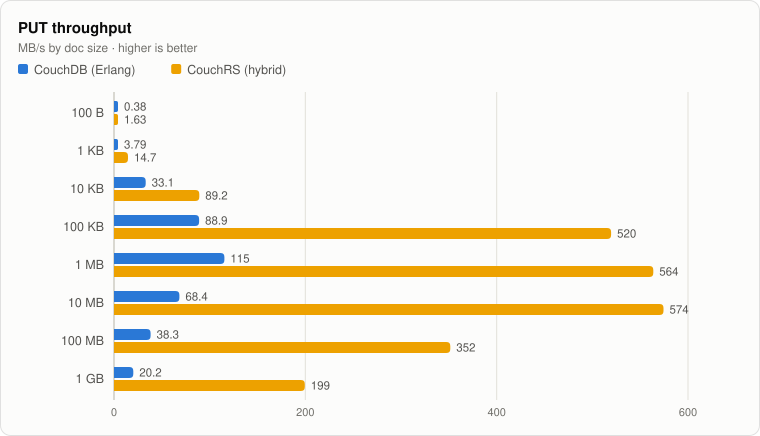

|  | CouchDB (Erlang), MB/s | CouchRS (hybrid), MB/s | CouchRS vs CouchDB |
|:--|--:|--:|--:|
| 100 B | 0.38 | 1.63 | 4.27× faster |
| 1 KB | 3.79 | 14.7 | 3.88× faster |
| 10 KB | 33.1 | 89.2 | 2.69× faster |
| 100 KB | 88.9 | 520 | 5.84× faster |
| 1 MB | 115 | 564 | 4.89× faster |
| 10 MB | 68.4 | 574 | 8.40× faster |
| 100 MB | 38.3 | 352 | 9.19× faster |
| 1 GB | 20.2 | 199 | 9.87× faster |

## Reads

Random GETs of documents (or their attachment) drawn from the loaded dataset in each size band. The dataset is larger than RAM, so many reads go to disk.

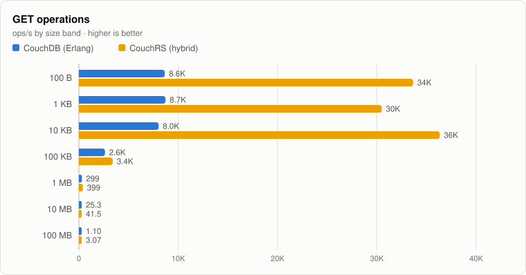

|  | CouchDB (Erlang), ops/s | CouchRS (hybrid), ops/s | CouchRS vs CouchDB |
|:--|--:|--:|--:|
| 100 B | 8.6K | 34K | 3.89× faster |
| 1 KB | 8.7K | 30K | 3.50× faster |
| 10 KB | 8.0K | 36K | 4.53× faster |
| 100 KB | 2.6K | 3.4K | 1.29× faster |
| 1 MB | 299 | 399 | 1.33× faster |
| 10 MB | 25.3 | 41.5 | 1.64× faster |
| 100 MB | 1.10 | 3.07 | 2.80× faster |

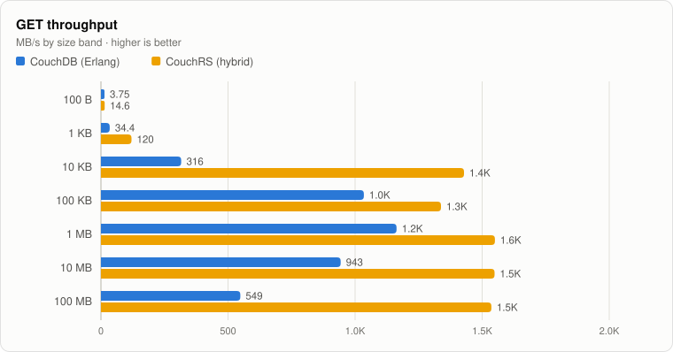

|  | CouchDB (Erlang), MB/s | CouchRS (hybrid), MB/s | CouchRS vs CouchDB |
|:--|--:|--:|--:|
| 100 B | 3.75 | 14.6 | 3.89× faster |
| 1 KB | 34.4 | 120 | 3.50× faster |
| 10 KB | 316 | 1.4K | 4.53× faster |
| 100 KB | 1.0K | 1.3K | 1.29× faster |
| 1 MB | 1.2K | 1.6K | 1.33× faster |
| 10 MB | 943 | 1.5K | 1.64× faster |
| 100 MB | 549 | 1.5K | 2.80× faster |

## Deletes

Deleting the documents created by the write test, with their current revision.

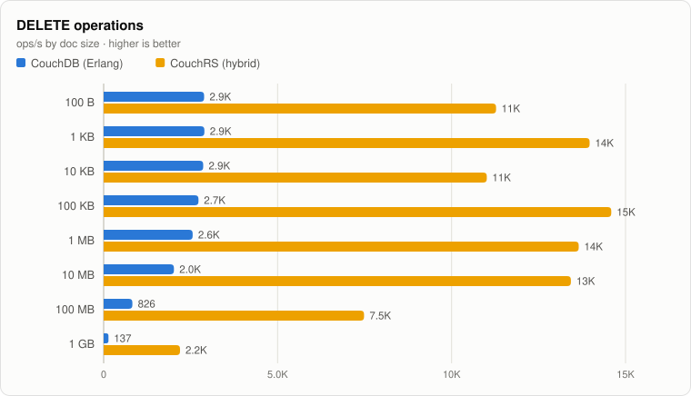

|  | CouchDB (Erlang), ops/s | CouchRS (hybrid), ops/s | CouchRS vs CouchDB |
|:--|--:|--:|--:|
| 100 B | 2.9K | 11K | 3.91× faster |
| 1 KB | 2.9K | 14K | 4.83× faster |
| 10 KB | 2.9K | 11K | 3.85× faster |
| 100 KB | 2.7K | 15K | 5.35× faster |
| 1 MB | 2.6K | 14K | 5.34× faster |
| 10 MB | 2.0K | 13K | 6.65× faster |
| 100 MB | 826 | 7.5K | 9.06× faster |
| 1 GB | 137 | 2.2K | 15.98× faster |

## Latency

Per-request latency from the client's side, measured for every operation in the tests above. The charts show p99 (nearest rank); the table after them has the mean and every percentile. Lower is better.

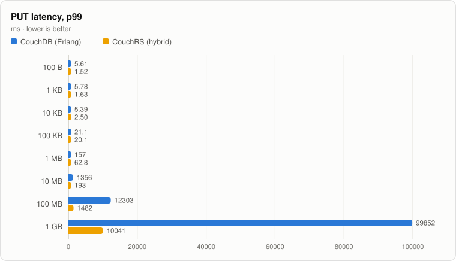

|  | CouchDB (Erlang), ms | CouchRS (hybrid), ms | CouchRS vs CouchDB |
|:--|--:|--:|--:|
| 100 B | 5.61 | 1.52 | 3.69× faster |
| 1 KB | 5.78 | 1.63 | 3.56× faster |
| 10 KB | 5.39 | 2.50 | 2.16× faster |
| 100 KB | 21.1 | 20.1 | 1.05× faster |
| 1 MB | 157 | 62.8 | 2.50× faster |
| 10 MB | 1356 | 193 | 7.04× faster |
| 100 MB | 12303 | 1482 | 8.30× faster |
| 1 GB | 99852 | 10041 | 9.94× faster |

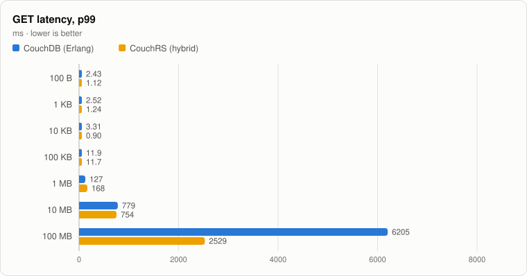

|  | CouchDB (Erlang), ms | CouchRS (hybrid), ms | CouchRS vs CouchDB |
|:--|--:|--:|--:|
| 100 B | 2.43 | 1.12 | 2.16× faster |
| 1 KB | 2.52 | 1.24 | 2.04× faster |
| 10 KB | 3.31 | 0.90 | 3.69× faster |
| 100 KB | 11.9 | 11.7 | 1.02× faster |
| 1 MB | 127 | 168 | 1.32× slower |
| 10 MB | 779 | 754 | 1.03× faster |
| 100 MB | 6205 | 2529 | 2.45× faster |

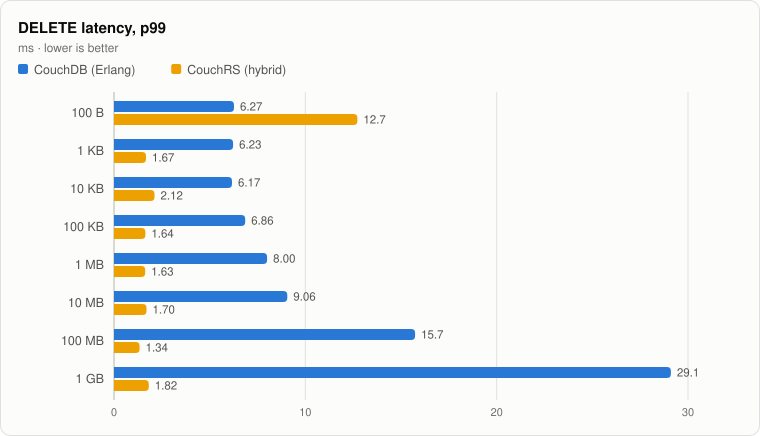

|  | CouchDB (Erlang), ms | CouchRS (hybrid), ms | CouchRS vs CouchDB |
|:--|--:|--:|--:|
| 100 B | 6.27 | 12.7 | 2.03× slower |
| 1 KB | 6.23 | 1.67 | 3.73× faster |
| 10 KB | 6.17 | 2.12 | 2.91× faster |
| 100 KB | 6.86 | 1.64 | 4.17× faster |
| 1 MB | 8.00 | 1.63 | 4.90× faster |
| 10 MB | 9.06 | 1.70 | 5.33× faster |
| 100 MB | 15.7 | 1.34 | 11.77× faster |
| 1 GB | 29.1 | 1.82 | 15.99× faster |

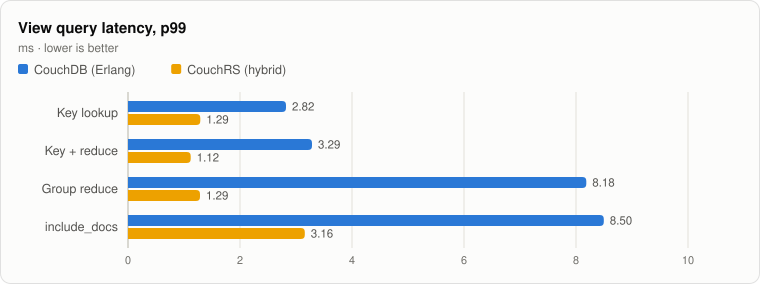

|  | CouchDB (Erlang), ms | CouchRS (hybrid), ms | CouchRS vs CouchDB |
|:--|--:|--:|--:|
| Key lookup | 2.82 | 1.29 | 2.19× faster |
| Key + reduce | 3.29 | 1.12 | 2.94× faster |
| Group reduce | 8.18 | 1.29 | 6.36× faster |
| include_docs | 8.50 | 3.16 | 2.69× faster |

Every operation: throughput, and latency in ms

| Operation | Server | ops/s | MB/s | mean | p50 | p90 | p95 | p99 | max |
|:--|:--|--:|--:|--:|--:|--:|--:|--:|--:|
| PUT 100 B | CouchDB (Erlang) | 3.8K | 0.38 | 4.13 | 4.09 | 4.48 | 4.64 | 5.61 | 6.73 |
| PUT 100 B | CouchRS (hybrid) | 16K | 1.63 | 0.94 | 0.91 | 1.27 | 1.35 | 1.52 | 1.71 |
| PUT 1 KB | CouchDB (Erlang) | 3.8K | 3.79 | 4.16 | 4.11 | 4.53 | 4.77 | 5.78 | 6.52 |
| PUT 1 KB | CouchRS (hybrid) | 15K | 14.7 | 1.04 | 1.04 | 1.37 | 1.46 | 1.63 | 1.89 |
| PUT 10 KB | CouchDB (Erlang) | 3.3K | 33.1 | 4.72 | 4.72 | 5.10 | 5.20 | 5.39 | 7.01 |
| PUT 10 KB | CouchRS (hybrid) | 8.9K | 89.2 | 1.72 | 1.72 | 2.11 | 2.26 | 2.50 | 2.87 |
| PUT 100 KB | CouchDB (Erlang) | 889 | 88.9 | 17.9 | 17.9 | 19.8 | 20.2 | 21.1 | 23.5 |
| PUT 100 KB | CouchRS (hybrid) | 5.2K | 520 | 3.03 | 2.70 | 3.42 | 3.74 | 20.1 | 24.5 |
| PUT 1 MB | CouchDB (Erlang) | 115 | 115 | 138 | 134 | 151 | 153 | 157 | 166 |
| PUT 1 MB | CouchRS (hybrid) | 564 | 564 | 28.3 | 21.6 | 51.4 | 56.8 | 62.8 | 72.4 |
| PUT 10 MB | CouchDB (Erlang) | 6.84 | 68.4 | 1146 | 1108 | 1316 | 1332 | 1356 | 1368 |
| PUT 10 MB | CouchRS (hybrid) | 57.4 | 574 | 138 | 134 | 178 | 182 | 193 | 199 |
| PUT 100 MB | CouchDB (Erlang) | 0.38 | 38.3 | 9891 | 9646 | 10562 | 11580 | 12303 | 12303 |
| PUT 100 MB | CouchRS (hybrid) | 3.52 | 352 | 1119 | 1095 | 1187 | 1306 | 1482 | 1482 |
| PUT 1 GB | CouchDB (Erlang) | 0.02 | 20.2 | 94307 | 89691 | 99852 | 99852 | 99852 | 99852 |
| PUT 1 GB | CouchRS (hybrid) | 0.2 | 199 | 10026 | 10019 | 10041 | 10041 | 10041 | 10041 |
| GET 100 B | CouchDB (Erlang) | 8.6K | 3.75 | 1.81 | 1.82 | 2.13 | 2.26 | 2.43 | 2.82 |
| GET 100 B | CouchRS (hybrid) | 34K | 14.6 | 0.44 | 0.36 | 0.83 | 0.93 | 1.12 | 1.37 |
| GET 1 KB | CouchDB (Erlang) | 8.7K | 34.4 | 1.80 | 1.79 | 2.16 | 2.27 | 2.52 | 3.01 |
| GET 1 KB | CouchRS (hybrid) | 30K | 120 | 0.49 | 0.44 | 0.84 | 0.93 | 1.24 | 1.86 |
| GET 10 KB | CouchDB (Erlang) | 8.0K | 316 | 1.97 | 1.87 | 2.65 | 2.91 | 3.31 | 4.13 |
| GET 10 KB | CouchRS (hybrid) | 36K | 1.4K | 0.43 | 0.41 | 0.60 | 0.68 | 0.90 | 1.24 |
| GET 100 KB | CouchDB (Erlang) | 2.6K | 1.0K | 6.06 | 5.35 | 10.0 | 10.9 | 11.9 | 13.0 |
| GET 100 KB | CouchRS (hybrid) | 3.4K | 1.3K | 4.09 | 3.64 | 7.08 | 8.15 | 11.7 | 217 |
| GET 1 MB | CouchDB (Erlang) | 299 | 1.2K | 52.9 | 45.3 | 104 | 115 | 127 | 136 |
| GET 1 MB | CouchRS (hybrid) | 399 | 1.6K | 39.8 | 29.4 | 82.7 | 110 | 168 | 308 |
| GET 10 MB | CouchDB (Erlang) | 25.3 | 943 | 306 | 254 | 579 | 693 | 779 | 807 |
| GET 10 MB | CouchRS (hybrid) | 41.5 | 1.5K | 190 | 143 | 386 | 520 | 754 | 1042 |
| GET 100 MB | CouchDB (Erlang) | 1.10 | 549 | 3176 | 2710 | 5655 | 5681 | 6205 | 6205 |
| GET 100 MB | CouchRS (hybrid) | 3.07 | 1.5K | 1215 | 1019 | 2102 | 2220 | 2529 | 2529 |
| DELETE 100 B | CouchDB (Erlang) | 2.9K | – | 5.49 | 5.47 | 5.86 | 5.96 | 6.27 | 10.5 |
| DELETE 100 B | CouchRS (hybrid) | 11K | – | 1.38 | 1.06 | 1.46 | 1.61 | 12.7 | 14.8 |
| DELETE 1 KB | CouchDB (Erlang) | 2.9K | – | 5.47 | 5.47 | 5.81 | 5.94 | 6.23 | 8.55 |
| DELETE 1 KB | CouchRS (hybrid) | 14K | – | 1.10 | 1.10 | 1.45 | 1.53 | 1.67 | 1.92 |
| DELETE 10 KB | CouchDB (Erlang) | 2.9K | – | 5.53 | 5.52 | 5.83 | 5.90 | 6.17 | 7.78 |
| DELETE 10 KB | CouchRS (hybrid) | 11K | – | 1.40 | 1.41 | 1.79 | 1.90 | 2.12 | 2.29 |
| DELETE 100 KB | CouchDB (Erlang) | 2.7K | – | 5.80 | 5.78 | 6.17 | 6.30 | 6.86 | 8.68 |
| DELETE 100 KB | CouchRS (hybrid) | 15K | – | 1.05 | 1.03 | 1.38 | 1.48 | 1.64 | 1.90 |
| DELETE 1 MB | CouchDB (Erlang) | 2.6K | – | 6.15 | 6.09 | 6.56 | 6.90 | 8.00 | 8.94 |
| DELETE 1 MB | CouchRS (hybrid) | 14K | – | 1.11 | 1.14 | 1.44 | 1.52 | 1.63 | 1.89 |
| DELETE 10 MB | CouchDB (Erlang) | 2.0K | – | 7.61 | 7.56 | 8.36 | 8.96 | 9.06 | 10.5 |
| DELETE 10 MB | CouchRS (hybrid) | 13K | – | 1.09 | 1.04 | 1.43 | 1.51 | 1.70 | 1.73 |
| DELETE 100 MB | CouchDB (Erlang) | 826 | – | 14.0 | 15.7 | 15.7 | 15.7 | 15.7 | 15.7 |
| DELETE 100 MB | CouchRS (hybrid) | 7.5K | – | 1.18 | 1.26 | 1.32 | 1.32 | 1.34 | 1.34 |
| DELETE 1 GB | CouchDB (Erlang) | 137 | – | 24.8 | 29.1 | 29.1 | 29.1 | 29.1 | 29.1 |
| DELETE 1 GB | CouchRS (hybrid) | 2.2K | – | 1.64 | 1.78 | 1.82 | 1.82 | 1.82 | 1.82 |
| View: Key lookup | CouchDB (Erlang) | 8.7K | 7.69 | 1.84 | 1.80 | 2.15 | 2.35 | 2.82 | 4.47 |
| View: Key lookup | CouchRS (hybrid) | 22K | 19.2 | 0.66 | 0.67 | 1.00 | 1.10 | 1.29 | 1.98 |
| View: Key + reduce | CouchDB (Erlang) | 7.7K | 0.34 | 2.07 | 2.00 | 2.75 | 2.94 | 3.29 | 4.07 |
| View: Key + reduce | CouchRS (hybrid) | 28K | 1.11 | 0.54 | 0.50 | 0.86 | 0.93 | 1.12 | 1.36 |
| View: Group reduce | CouchDB (Erlang) | 1.1K | 0.27 | 7.19 | 7.22 | 7.71 | 7.84 | 8.18 | 8.33 |
| View: Group reduce | CouchRS (hybrid) | 11K | 2.47 | 0.73 | 0.75 | 1.02 | 1.13 | 1.29 | 1.39 |
| View: include_docs | CouchDB (Erlang) | 2.3K | 223 | 6.81 | 6.75 | 7.67 | 7.97 | 8.50 | 9.05 |
| View: include_docs | CouchRS (hybrid) | 11K | 1.1K | 1.37 | 1.12 | 2.43 | 2.65 | 3.16 | 4.06 |

## Views

A JavaScript map function (`emit([doc.band, doc.group], doc.size)`) with the built-in `_sum` reduce, built over every document, then queried. Both servers run map functions in QuickJS.

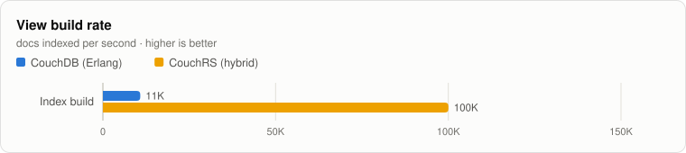

|  | CouchDB (Erlang), docs/s | CouchRS (hybrid), docs/s | CouchRS vs CouchDB |
|:--|--:|--:|--:|
| Index build | 11K | 100K | 9.24× faster |

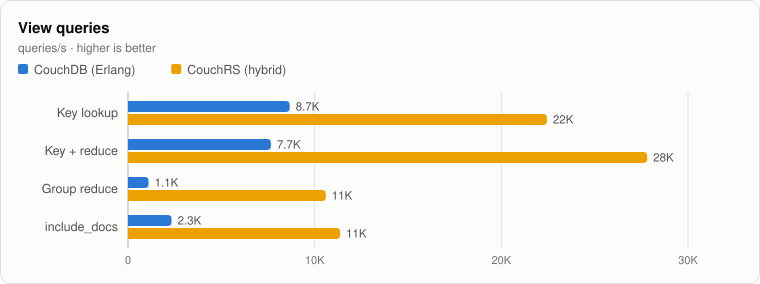

|  | CouchDB (Erlang), q/s | CouchRS (hybrid), q/s | CouchRS vs CouchDB |
|:--|--:|--:|--:|
| Key lookup | 8.7K | 22K | 2.59× faster |
| Key + reduce | 7.7K | 28K | 3.63× faster |
| Group reduce | 1.1K | 11K | 9.61× faster |
| include_docs | 2.3K | 11K | 4.86× faster |

## Connection scaling

Simulated hosts are added one at a time, each holding 15K keep-alive connections from its own private address, up to 90K. Every client runs a closed loop: it sends its next request as soon as the last one answers, choosing evenly among GET of a random 1.0K-byte document (from 100K), PUT of its own document, and GET of a random 4.0K-byte attachment. After each host joins, the load settles for 15 s and is then measured for 60 s. Each load generator is its own c7i.4xlarge in the server's availability zone; its six private addresses are the six hosts.

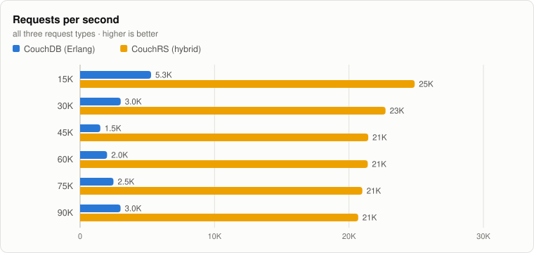

|  | CouchDB (Erlang), req/s | CouchRS (hybrid), req/s | CouchRS vs CouchDB |
|:--|--:|--:|--:|
| 15K | 5.3K | 25K | 4.71× faster |
| 30K | 3.0K | 23K | 7.52× faster |
| 45K | 1.5K | 21K | 14.23× faster |
| 60K | 2.0K | 21K | 10.65× faster |
| 75K | 2.5K | 21K | 8.46× faster |
| 90K | 3.0K | 21K | 6.87× faster |

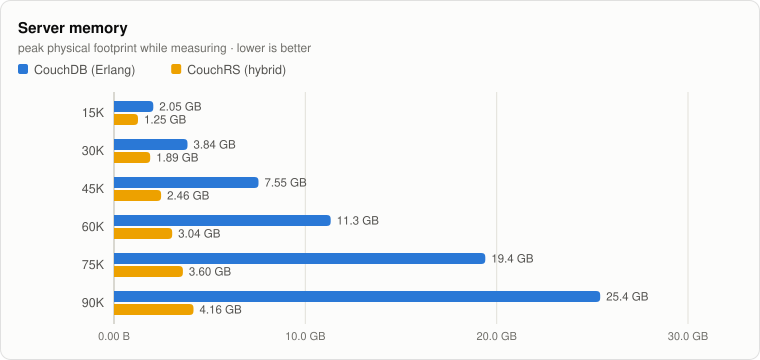

|  | CouchDB (Erlang) | CouchRS (hybrid) | CouchRS vs CouchDB |
|:--|--:|--:|--:|
| 15K | 2.05 GB | 1.25 GB | 1.64× faster |
| 30K | 3.84 GB | 1.89 GB | 2.03× faster |
| 45K | 7.55 GB | 2.46 GB | 3.07× faster |
| 60K | 11.3 GB | 3.04 GB | 3.72× faster |
| 75K | 19.4 GB | 3.60 GB | 5.39× faster |
| 90K | 25.4 GB | 4.16 GB | 6.11× faster |

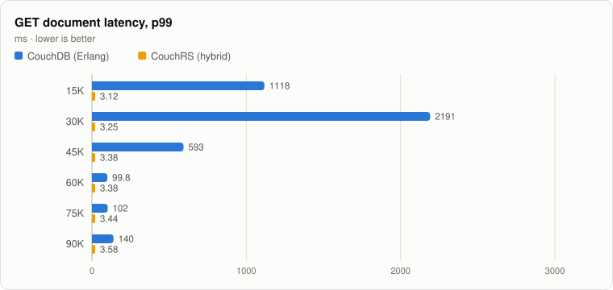

|  | CouchDB (Erlang), ms | CouchRS (hybrid), ms | CouchRS vs CouchDB |
|:--|--:|--:|--:|
| 15K | 1118 | 3.12 | 358.30× faster |
| 30K | 2191 | 3.25 | 675.24× faster |
| 45K | 593 | 3.38 | 175.65× faster |
| 60K | 99.8 | 3.38 | 29.55× faster |
| 75K | 102 | 3.44 | 29.55× faster |
| 90K | 140 | 3.58 | 39.00× faster |

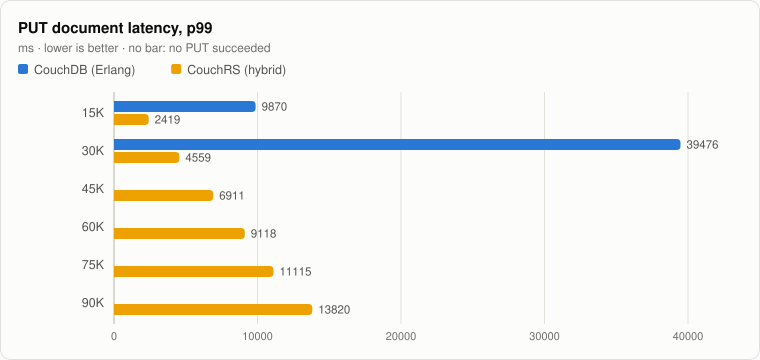

|  | CouchDB (Erlang), ms | CouchRS (hybrid), ms | CouchRS vs CouchDB |
|:--|--:|--:|--:|
| 15K | 9870 | 2419 | 4.08× faster |
| 30K | 39476 | 4559 | 8.66× faster |
| 45K | – | 6911 | – |
| 60K | – | 9118 | – |
| 75K | – | 11115 | – |
| 90K | – | 13820 | – |

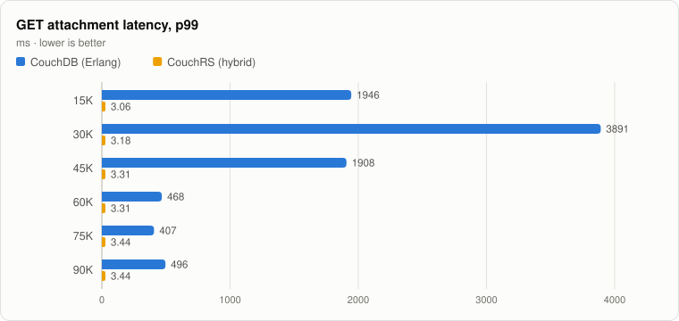

|  | CouchDB (Erlang), ms | CouchRS (hybrid), ms | CouchRS vs CouchDB |
|:--|--:|--:|--:|
| 15K | 1946 | 3.06 | 636.29× faster |
| 30K | 3891 | 3.18 | 1223.10× faster |
| 45K | 1908 | 3.31 | 576.31× faster |
| 60K | 468 | 3.31 | 141.27× faster |
| 75K | 407 | 3.44 | 118.21× faster |
| 90K | 496 | 3.44 | 144.09× faster |

Every step (latency in ms; errors counted during the measured window)

| Server | Clients | req/s | GET p99 | PUT p99 | Attachment p99 | HTTP errors | Memory | CPU cores |
|:--|--:|--:|--:|--:|--:|--:|--:|--:|
| CouchDB (Erlang) | 15K | 5.3K | 1118 | 9870 | 1946 | 0 | 2.05 GB | 6.1 |
| CouchDB (Erlang) | 30K | 3.0K | 2191 | 39476 | 3891 | 0 | 3.84 GB | 4.1 |
| CouchDB (Erlang) | 45K | 1.5K | 593 | – | 1908 | 45K | 7.55 GB | 3.6 |
| CouchDB (Erlang) | 60K | 2.0K | 99.8 | – | 468 | 60K | 11.3 GB | 4.6 |
| CouchDB (Erlang) | 75K | 2.5K | 102 | – | 407 | 75K | 19.4 GB | 5.2 |
| CouchDB (Erlang) | 90K | 3.0K | 140 | – | 496 | 90K | 25.4 GB | 5.9 |
| CouchRS (hybrid) | 15K | 25K | 3.12 | 2419 | 3.06 | 0 | 1.25 GB | 4.1 |
| CouchRS (hybrid) | 30K | 23K | 3.25 | 4559 | 3.18 | 0 | 1.89 GB | 4.0 |
| CouchRS (hybrid) | 45K | 21K | 3.38 | 6911 | 3.31 | 0 | 2.46 GB | 3.9 |
| CouchRS (hybrid) | 60K | 21K | 3.38 | 9118 | 3.31 | 0 | 3.04 GB | 3.9 |
| CouchRS (hybrid) | 75K | 21K | 3.44 | 11115 | 3.44 | 0 | 3.60 GB | 3.9 |
| CouchRS (hybrid) | 90K | 21K | 3.58 | 13820 | 3.44 | 0 | 4.16 GB | 3.9 |

## View compaction

Incremental index updates followed by view compaction. 200,000 small documents are inserted, updated three times and then deleted, and the index is brought up to date after each round, so it ends with the rows it started with plus whatever dead space incremental updates leave. Then the index is compacted. CouchDB's background indexer updates its index while the churn is written, so its index update times are not shown.

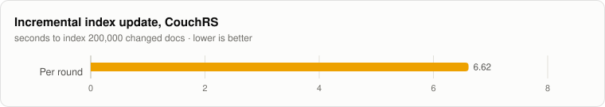

|  | CouchRS (hybrid), s |
|:--|--:|
| Per round | 6.62 |

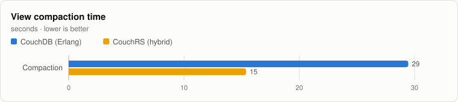

|  | CouchDB (Erlang), s | CouchRS (hybrid), s | CouchRS vs CouchDB |
|:--|--:|--:|--:|
| Compaction | 29 | 15 | 1.91× faster |

|  | CouchDB (Erlang) | CouchRS (hybrid) | CouchRS vs CouchDB |
|:--|--:|--:|--:|
| Peak extra memory | -20115456.00 B | 108 MB | -5.37× slower |

|  | CouchDB (Erlang) | CouchRS (hybrid) | CouchRS vs CouchDB |
|:--|--:|--:|--:|
| Peak extra disk | 175 MB | 216 MB | 1.23× slower |

Index file sizes: start is the index before the churn; before and after bracket the compaction.

| Server | File at start | File before | Live before | File after | Reclaimed | Time |
|:--|--:|--:|--:|--:|--:|--:|
| CouchDB (Erlang) | 2.00 GB | 2.10 GB | 187 MB | 175 MB | 1.93 GB | 29.5 s |
| CouchRS (hybrid) | 213 MB | 358 MB | 213 MB | 213 MB | 144 MB | 15.4 s |

## Replication

One full replication of the loaded database into a new database on the same server, driven by CouchDB's own replicator in both cases. That replicator talks to CouchRS over HTTP, so this also shows the two interoperate.

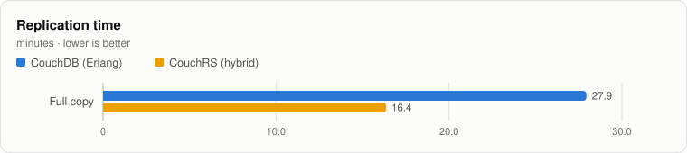

|  | CouchDB (Erlang), min | CouchRS (hybrid), min | CouchRS vs CouchDB |
|:--|--:|--:|--:|
| Full copy | 27.9 | 16.4 | 1.71× faster |

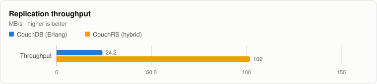

|  | CouchDB (Erlang), MB/s | CouchRS (hybrid), MB/s | CouchRS vs CouchDB |
|:--|--:|--:|--:|
| Throughput | 24.2 | 102 | 4.21× faster |

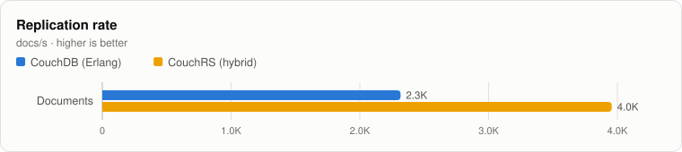

|  | CouchDB (Erlang), docs/s | CouchRS (hybrid), docs/s | CouchRS vs CouchDB |
|:--|--:|--:|--:|
| Documents | 2.3K | 4.0K | 1.71× faster |

## Compaction

Compacting the loaded database to reclaim the space its dead revisions use. CouchDB copies the live documents and attachments into a new file and swaps it in. CouchRS drops dead revision bodies and attachment chunks, then has RocksDB compact its files.

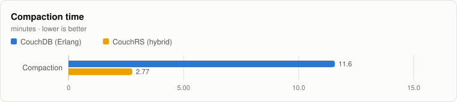

|  | CouchDB (Erlang), min | CouchRS (hybrid), min | CouchRS vs CouchDB |
|:--|--:|--:|--:|
| Compaction | 11.6 | 2.77 | 4.18× faster |

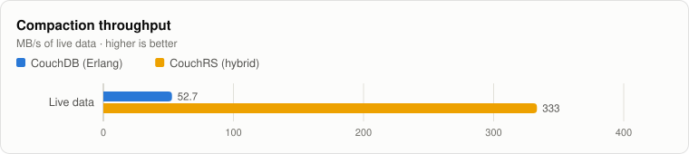

|  | CouchDB (Erlang), MB/s | CouchRS (hybrid), MB/s | CouchRS vs CouchDB |
|:--|--:|--:|--:|
| Live data | 52.7 | 333 | 6.32× faster |

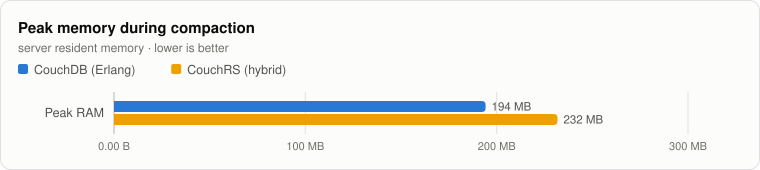

|  | CouchDB (Erlang) | CouchRS (hybrid) | CouchRS vs CouchDB |
|:--|--:|--:|--:|
| Peak RAM | 194 MB | 232 MB | 1.19× slower |

|  | CouchDB (Erlang) | CouchRS (hybrid) | CouchRS vs CouchDB |
|:--|--:|--:|--:|
| Peak extra disk | 37.7 GB | 51.0 GB | 1.35× slower |

| Server | File before | Live before | File after | Reclaimed | Time | Peak RAM | Peak extra disk |
|:--|--:|--:|--:|--:|--:|--:|--:|
| CouchDB (Erlang) | 46.7 GB | 36.7 GB | 36.6 GB | 10.0 GB | 11.6 min | 194 MB | 37.7 GB |
| CouchRS (hybrid) | 60.6 GB | 55.2 GB | 60.6 GB | 0.00 B | 2.8 min | 232 MB | 51.0 GB |

## Disk

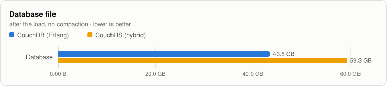

|  | CouchDB (Erlang) | CouchRS (hybrid) | CouchRS vs CouchDB |
|:--|--:|--:|--:|
| Database | 43.5 GB | 59.3 GB | 1.36× slower |

|  | CouchDB (Erlang) | CouchRS (hybrid) | CouchRS vs CouchDB |
|:--|--:|--:|--:|
| View index | 2.00 GB | 213 MB | 9.38× faster |

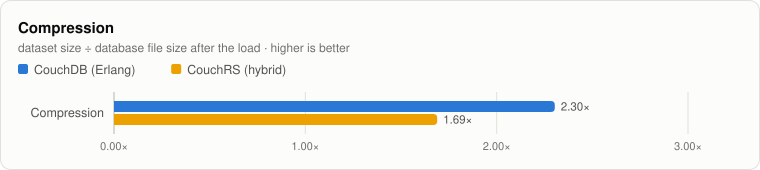

|  | CouchDB (Erlang) | CouchRS (hybrid) | CouchRS vs CouchDB |
|:--|--:|--:|--:|
| Compression | 2.30× | 1.69× | 1.36× slower |

## Method

- Servers: Apache CouchDB 3.5.3 (official apache/couchdb:3.5.3 image, Erlang/OTP 27, QuickJS) and CouchRS, each on its own i4i.4xlarge (16 vCPU, 128 GB RAM, data on the instance's local NVMe, XFS). Each server had its own c7i.4xlarge load generator. The pairs ran at the same time in us-east-1a, in one cluster placement group, alongside two other CouchRS builds not shown here.
- Durability: Linux fdatasync for every server (CouchDB's file:datasync; for CouchRS, RocksDB's WAL sync for documents and sync_data for view index files).
- CouchDB: single node, q=1 (one shard, like CouchRS), automatic compaction (smoosh) off, connection cap raised to 200,000, Erlang port limit 262,144, listen backlog 1,024 (tokio's default, which CouchRS uses). All nodes: 2M open files, somaxconn 65,535, local ports 1024-65535.
- Dataset, phases and the load generator (bench/couchbench) are the same as the Mac runs: 100 GB, deterministic from a fixed seed, sizes 100 B to 1 GB, generated text.
- Replication used a CouchDB replicator: CouchDB's own for CouchDB, and a separate CouchDB container on the CouchRS server node (port 15984) for CouchRS, copying each database to a new database on the same server.
- View queries and the per-size GET/PUT/DELETE tests use the same 16 (or fewer) concurrent clients as on the Mac, so across a network their rates are bounded by round trips (about 0.5 ms here) as well as by the server; compare the servers within this report rather than against the Mac numbers.
- Server memory and CPU come from a monitor on the server node (resident set and, on Linux, proportional set size; CPU from /proc), matched to each measured window by wall-clock time.
- CouchRS's hybrid engine stores documents in RocksDB and view indexes in its B-tree engine: an append-only index file with a reduction stored in every node.
- View compaction streams each live B-tree, already in key order, into a bottom-up builder, so every node is written once.
